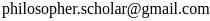

**Hello!** 

This website is the open notebook of Elliott Collin Ploutz. I am a philosopher, computer scientist, [YouTuber](https://www.youtube.com/c/PhilosopherScholar), and aspiring influencer. These pages are my public notes on various topics I investigate. If you’re interested in living a good life, optimizing productivity, philosophy, computer science, artificial intelligence, and making sense of this absurd universe we live in, I hope something on this site saves you time and energy.

### You can read an abridged [autobiography here](/lifestory/)

Please feel free to contact me at:

 

---

 
 
 
 
 
 

I'm interested in alternative social media that combats the problems we face (book) today. Follow me on <a rel="me" href="https://fosstodon.org/@philosopher">Fosstodon</a>, a free and opensource platform.

## Hey! Give me money.

If you send me money, I promise it will probably go to important uses like funding my projects, charities, or my extravagant lifestyle.

Please consider becoming a patron on [Patreon](https://www.patreon.com/philosopherscholar).

<a href="https://www.patreon.com/bePatron?u=12450094" data-patreon-widget-type="become-patron-button">Become a Patron!</a>

You can also use [Paypal](https://www.paypal.me/ploutze) for one-time donations. (Buy me a burrito?)

